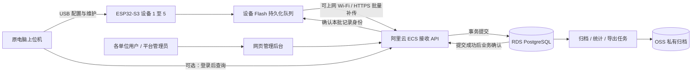

# 检测设备直连阿里云实施方案

版本：V1.2（设计方案及云端内部部署进展）  
日期：2026-11-16  
依据：当前 ESP32-S3 固件、PyQt 上位机及 SQLite 数据处理代码。

进展（2026-11-16）：已新增独立本地接收服务，上传、补传去重和单位隔离通过 37 项接口测试；当前按用户要求暂不制作模拟设备。详见 [运行说明](../cloud_backend/README.md) 和 [验证记录](../cloud_backend/VALIDATION.md)。下文 5 台并发、云资源、固件改造和归档仍是后续目标，不代表已完成或已验证。

进展（2026-11-17）：已复用现有北京 ECS，完成接收服务部署、开机启动及 10 项云端 HTTP 验证。随后为首台 ESP32-S3 配置了公网 IP 的 HTTPS 上传入口和独立设备凭证，访问限于测试 Wi-Fi 出口。5 台并发及长期归档仍待验证。参见[云端接收服务部署记录](云端接收服务部署记录.md)与[设备补传联调](../deploy/设备补传联调.md)。

## 1. 已确认需求与本次设计结论

| 项目 | 设计基线 |
|---|---|
| 接入方式 | 设备直接连接阿里云，不依赖现场电脑转发 |
| 当前与首期规模 | 当前 1 台实机，首期交付按 5 台独立身份、同时补传设计 |
| 联网要求 | 允许离线采集，回到可上网的 Wi-Fi 后自动批量补传 |
| 单位管理 | 一个业务平台服务多个单位，各单位的数据和权限隔离 |
| 保存要求 | 默认不配置业务数据自动过期，以 5 年做容量预算，按增长扩容；原始明细分层存储 |
| 日常入口 | 浏览器管理后台；原上位机用于配网、维护、现场调试及可选云端查看 |
| 首版传输 | HTTPS 批量上传到阿里云 ECS 上的接收服务，数据库提交成功后返回业务确认 |
| 技术建议 | Python/FastAPI + PostgreSQL/RDS + OSS + Web 管理界面 |

这里的“直连阿里云”采用设备直接访问部署在阿里云上的业务服务。首版不要求购买阿里云物联网平台，也不自建 MQTT Broker。对于 5 台设备、非持续在线、以历史补传为主的场景，HTTPS 请求的响应可以直接承担入库确认，减少中间转发和第二条确认通道。

这是本项目的工程选型，并非阿里云产品能力限制。后续如果需要大量长连接、即时下行或托管设备运维，可增加“MQTT → 阿里云物联网平台 → AMQP 消费服务”适配器，保持业务数据模型不变。MQTT PUBACK 仍不能替代数据库入库确认。参考：[阿里云服务端订阅](https://www.alibabacloud.com/help/zh/iot/getting-started/subscribe-to-device-messages-from-iot-platform)。

## 2. 总体结构与设备工作流程



1. 设备正常采样、识别和定位，按既有记录周期写入本地 Flash。
2. 无网络时保留未确认记录；联网失败不阻塞检测和定位。
3. 连接已配置且可访问互联网的 Wi-Fi，完成 DNS、时钟准备、TLS 校验和设备认证。
4. 按队列最早记录顺序读取一批，发送到云端。设备一次只允许一批历史记录等待确认。
5. 云端校验身份和内容，在同一事务中写入记录、去重凭据及后台任务凭据。
6. 事务提交成功后，返回与请求匹配的批次号、记录身份列表和处理结果。
7. 设备校验响应后调用原有队列确认/空间回收机制。响应丢失时重传原批次，云端识别重复并再次确认。
8. 上传结束报告队列剩余量。用户能看到“最后联网时间”“待上传条数”“本次同步进度”，而不是把“已连上 Wi-Fi”当作同步完成。

联网仅意味着进入补传流程。设备没有蜂窝通信模块，离开 Wi-Fi 后仍不会自行获得移动网络；返回的网络需要支持 ESP32-S3 的 2.4 GHz Wi-Fi，首版按普通 WPA2 热点设计，不支持网页认证网络。

## 3. 当前代码已经具备什么，以及必须修正的差距

| 现有位置 | 核查结果 | 对云端改造的影响 |
|---|---|---|
| `gun_detection/src/wifi_transport.cpp`、`include/wifi_transport.h` | Wi-Fi、局域网发现、UDP、记录生成、发送与 ACK 集中在同一类；每批最多 7 条，发送缓冲 1472 字节 | 需要拆分采集/存储调度与传输适配，不能直接把电脑 IP 换成云 IP |
| `gun_detection/include/telemetry_spool.h` | TLM2 固定 90 字节，包含 sequence、bootId、uptimeMs、shotId、recordKind；兼容读取 TLM1 | 首版保留 Flash 布局和历史缓存，避免协议改造导致数据清空 |
| `gun_detection/src/telemetry_spool.cpp` | LittleFS 分段、校验、NVS 序号块预留、按队首确认和回收；`acknowledgeBatch()` 当前最多确认 20 条 | 首版云上传批次最多 20 条，复用确认机制，不引入设备内并行乱序确认 |
| `gun_detection/include/system_config.h` | 设备编号是统一编译常量；Wi-Fi 也是编译配置；GPS 轨迹周期 1000 ms、普通及低功耗传感器周期 10000 ms | 必须变成逐台身份和可维护的联网配置；不能给多台设备烧录相同云身份 |
| `gun_detection/large_storage_16mb.csv` | 16 MiB Flash，应用槽约 3 MiB，文件系统分区 `0xC00000` 即 12 MiB；只有 app0 | 需要评估离线缓存；首版保留 USB 升级，远程 OTA 不在现有分区上直接启用 |
| `gun_detection/src/main.cpp` | ADC 有独立任务，GPS、事件调度和传输仍在主循环协作 | HTTPS 不能阻塞主循环；需独立网络任务和明确的队列所有权 |
| `data_monitor/gun_wifi_monitor.py` | `UdpReceiver` 使用 SQLite 事务，提交记录和凭据后 ACK；`telemetry` 表没有设备列 | 可复用事务原则；现有通用传感器表不能直接当作多设备云表迁移 |
| `data_monitor/monitor_lib/transfer_control.py` | compact-v1/v2 解码可独立使用；`TransferControl` 只维护一个当前设备状态/地址 | 抽离协议解码；多设备管理必须改为按设备维护状态 |
| `trajectory_store.py`、`shot_store.py` | 轨迹按设备/上电分组，射击按身份去重；显示用 shots 只有四列 | 可复用业务规则；云表必须显式带单位、设备、上电及完整唯一键，不能依赖 SQLite rowid |
| `trajectory_map.py`、`assets/trajectory_map.html` | 地图回放、WGS-84 转显示坐标和抽样已实现，但数据源直接访问本地 SQLite | 复用交互和坐标逻辑，将数据源换成授权 API |

代码优先于 README 中过时的参数说明：目前普通模式待写记录会立即尝试落 Flash，只有高频容量测试等条件才积攒批次，不能直接沿用“总是攒满 20 条才写”的旧描述。当前休眠时段也与 README 的默认示例不同，实施时以配置和实机为准，不修改用户现有时段。

现有数据完整性边界：射击时间/位置有持久化记录；声音/振动的详细触发事件目前主要走 RAM 实时队列，离线期间不能保证逐事件完整保留。原始 1 kHz 波形或音频也没有完整录制文件。首版承诺保留现有持久化的轨迹、周期传感器摘要、射击时间/位置；如需详细声振事件或波形离线回溯，必须另外增加持久化记录格式及容量预算，不能从已有摘要中还原。

## 4. 设备端修改清单

### 4.1 身份、配网与配置

- 新增 `device_identity.h/.cpp`、`device_config.h/.cpp`：保存不可随重启变化的设备 UUID、逐台随机访问凭据、凭据版本、存储世代 `storageEpoch`、云端域名和 Wi-Fi 配置到 NVS。
- UUID 是业务主身份，板卡 MAC 仅用于登记核验。5 台设备分别登记和发放凭据，不共用密钥；设备不保存阿里云主账号 AccessKey。
- 首版通过 USB 串口维护工具完成登记和配网，可保存多个授权热点；更换单位现场网络不需重新编译固件。配置操作有物理接入前提和确认反馈，读取配置不回显密钥。
- 原 `system_config.h` 保留无敏感默认参数；逐台配置不进入 Git。增加云端/本地维护模式开关。
- `storageEpoch` 在首次启用云端身份或受控清空存储时生成；普通重启不改变。云记录身份结合 epoch、记录自身 bootId 和 sequence，防止清空 NVS 后序号从头开始引发冲突。
- 未清空的旧记录保留原 bootId。清空 NVS、换板、改变身份或重分区前，必须先补传并验证旧队列已清空；异常丢失世代信息时进入维护恢复流程，不能静默使用新身份上传旧队列。

### 4.2 传输与任务拆分

建议新增 `cloud_transport.h/.cpp`，拆出 `telemetry_recorder.h/.cpp`；`wifi_transport` 逐步成为网络和旧 UDP 适配层。

- 记录生成与 Flash 读写由一个任务拥有。网络任务只接收不可变批次副本，通过消息队列返回确认结果，不并发操作 `TelemetrySpool`、LittleFS 或现有共享状态。
- HTTPS 放在独立 FreeRTOS 网络任务；为连接、读写、取消设置有界超时。主循环继续处理 GPS、待写事件和采集调度。
- 复用 TLS/HTTP 连接，避免每批重新握手。首版发送 1～20 条、请求体最多 8 KiB，网络任务只保留一个批次；服务端最多接收 64 条且限制请求体大小，为以后扩展留余量。
- 按实际序列化长度截断批次，JSON 编解码使用明确字段与类型校验，不再依赖 `strstr` 匹配 ACK。
- 初始限速上限 2 批/秒/设备，失败使用指数退避与随机抖动，遵守服务端 `Retry-After`。以上为起始参数，实机验证后调整。
- 401/403 停止快速重试并报告凭据问题；413 缩小批次；429 退避；5xx/超时原批重试；内容冲突或坏记录暂停该队列并告警，不擅自丢弃队首记录。
- 原 UDP 250 ms 状态用于现场调试。云状态初始改为联网时每 30 秒上报一次，补传进度可随批次响应更新，不把高频调试状态作为永久轨迹反复保存。

ESP32-S3 官方 HTTP 客户端支持 HTTPS、根证书验证和连接复用，且同步请求会阻塞调用任务，正是需要任务隔离的原因。具体调用使用当前 PlatformIO/Arduino 所带兼容版本，不在此次改造中盲目升级整个框架。参考：[Espressif HTTP 客户端](https://docs.espressif.com/projects/esp-idf/en/stable/esp32s3/api-reference/protocols/esp_http_client.html)。

### 4.3 数据确认、安全与时间

- TLS 必须验证证书链和域名，不使用跳过证书校验的模式；配置证书轮换/根证书更新维护办法。
- 采用逐台高强度随机令牌，经 HTTPS 请求头认证；云端保存令牌摘要，支持撤销和轮换。限制跨域重定向，日志中屏蔽认证头。设备被停用不等于删除其历史记录。
- 未获得有效日历时间时，先尝试 GPS/NTP 校时再建立 TLS；失败保留缓存并报告，不能为了连接成功关闭证书有效期校验。
- 记录发生时间和上传认证时间相互独立：几天前的历史数据允许今天上传，不能因事件时间较旧而拒绝有效补传。
- 首版 wire 协议可沿用 compact-v2 的记录数组，增加版本化外层封装。64 位 sequence、uptimeMs 以十进制字符串传输，bootId/epoch 用字符串，避免网页 JavaScript 的大整数精度损失。
- 收到 HTTP 200 还需验证完整 JSON、batchId、设备身份、epoch 和本批完整身份列表匹配，才可确认；严禁仅按“返回的最大序号”删除记录。
- NVS 序号按块预留，重启后出现数值空洞是合法现象；确认按队列实际记录顺序，不要求 sequence 数值逐个连续。

### 4.4 低功耗、补传窗口与存满策略

- 普通模式采集与补传并行；保留已有“仅传输”能力，供人工集中回收时暂停采集、加快上传。
- 低功耗模式原有短 Wi-Fi 窗口可能不足以完成积压补传。增加有界的“补传窗口”：有进展时延长连接，达到最长时限、无进展超时或进入既定休眠时退出，剩余数据下次继续。
- 第一版默认保持用户已有休眠优先级。设备在休眠时段返回网络不保证立即上传；维护工具允许明确进入一次性维护窗口，显示结束时间，届时恢复原策略，不能无限期暂停检测。
- 一期远程指令使用设备主动轮询拉取，不依赖公网入站。命令含设备、当前启动标识、commandId、失效时间和执行回执；过期“停止采集/仅传输”命令不跨重启执行。离线时界面显示“待设备联网”，不能显示已执行。
- 增加 80%/90% 缓存告警。建议预留部分空间给关键射击记录，满前停止/降低普通轨迹写入并明确记录数据缺口；不覆盖未确认数据。预留策略需改造队列写入判定并实测，现有代码没有这一保证。
- Flash 完全不可用或保留空间也耗尽时，任何软件方案都无法保证新事件继续持久化，必须报告可见故障。
- 首版保留 TLM1/TLM2 兼容，不调整分区。后续 OTA 需双应用槽，调整分区前先上传旧队列；现有代码发现分区大小变化会格式化旧文件系统，必须纳入升级前置检查。

## 5. 上位机分别改什么

上位机不再承担正式云链路的入库确认。设备云端模式下，即使电脑关闭，设备也能直接上传。

| 文件/模块 | 修改内容 |
|---|---|
| `gun_wifi_monitor.py` | 保留本地调试，界面区分“本地维护”和“云端查看”；云端查看使用单位用户登录，增加设备选择，不复用单设备全局计数 |
| `monitor_lib/transfer_control.py` | 将逐设备控制状态分开；云端控制走 API 和命令回执，不向远端设备 UDP 地址发命令 |
| 新增 `monitor_lib/cloud_client.py` | 用户登录、分页查询、超时、令牌刷新、退出清理；凭据不保存到普通配置文件或日志 |
| 新增串口配置工具 | 逐台写入设备 UUID、令牌、Wi-Fi、云地址；读取固件版本、云连接状态、缓存量和同步结果 |
| `trajectory_map.py` | 将 SQLite 查询抽象为数据源接口；云端模式按设备/boot 分页取轨迹，后台线程请求避免 UI 卡顿 |
| `trajectory_map.html` | 保留轨迹、回放、坐标转换；适配云 API 字段与长历史抽样 |
| `trajectory_store.py`、`shot_store.py` | 继续支持本地旧库；业务身份规则抽离供服务端复用，SQL 不能直接照搬为 PostgreSQL |
| 新增历史导入工具 | 只读导入旧 SQLite，生成迁移批次报告；保留原数据库备份 |

正式数据确认只能有一个权威：云端模式下关闭本地历史上传 ACK 路径，不能让电脑先确认并清除设备缓存、云端却没有数据。本地维护模式若用于真实历史回收，则先明确切换，并由独立的受控历史导入流程上传云端。

现有 `telemetry` 表缺设备标识，四列 `shots` 也不能孤立恢复完整身份。导入时优先联查 `track_points`、会话和原库凭据。无法确定设备/单位的记录放入“历史待归属”，人工核对后入统计，不能自动猜测归属。

日常用户直接用网页即可。上位机云查看是辅助入口，可以在核心云链路完成后交付。

## 6. 云端新增服务、数据表与接口

### 6.1 建议目录

```text
cloud_backend/
  app/api/             # 设备接口、用户接口
  app/auth/            # 设备凭据、用户会话、权限
  app/ingestion/       # 校验、幂等接收、入库
  app/models/          # 数据模型与迁移
  app/workers/         # 归档、统计、命令、导出
  tests/               # 补传、隔离、恢复、性能验证
cloud_web/             # 网页管理界面
shared_protocol/       # 与 PyQt 无关的解析/校验及协议样例
deploy/                # 部署配置、监控、备份恢复和升级说明
```

应用和 worker 可在同一 ECS 上分进程/容器运行。首版用数据库任务表驱动后台任务，不强制引入 Redis、消息队列或 Kubernetes。

### 6.2 核心数据模型

| 数据表 | 关键内容与约束 |
|---|---|
| `tenants` | 单位、状态、数据保留策略 |
| `users` / `memberships` | 用户、单位成员关系、角色；管理员可被授权加入多个单位 |
| `devices` / `device_credentials` | 内部设备主键、UUID、所属单位、凭据摘要/版本、固件、最后通信和同步状态 |
| `device_sessions` | 设备/epoch/bootId、上电时间线与校时依据 |
| `ingest_receipts` | 设备、epoch、原始 bootId、sequence、记录摘要、接收结果；全局唯一约束负责跨分区去重 |
| `sensor_records` / `track_points` | tenant_id、设备、来源身份、recordKind、原始时间、UTC 时间、uptime、received_at、有效性和原始字段 |
| `shot_events` | 设备/epoch/bootId/shotId 唯一；定位有效性、事件时间、人工标记和审计引用 |
| `device_commands` | 单位、设备、commandId、TTL、目标启动标识、状态与执行回执 |
| `daily_statistics` | 按单位/设备/事件日期统计，支持迟到数据重新计算 |
| `outbox_jobs` | 入库事务内创建归档/统计任务，失败可恢复重试 |
| `archive_manifest` | 单位、设备、时间/上电范围、OSS key、记录数、哈希、协议版本、归档及恢复状态 |
| `audit_logs` / `export_jobs` | 登录、归属变更、敏感查询/导出、后台操作和导出文件身份 |

所有业务表显式带 `tenant_id`，关联使用一致的单位/设备约束。64 位无符号值可存 `NUMERIC(20,0)` 或受约束文本，不直接假设 PostgreSQL 有 uint64。原始时间字符串始终保留，校时可确定时另外生成 UTC 时间，界面按北京时间显示。

大量明细可按接收月份分区，另建单位/设备/事件时间索引；补传数据可能很旧，不能仅按事件时间将其拒绝或写入已删除分区。分区表的局部唯一索引不能替代独立全局去重凭据。

### 6.3 接口基线

| 接口 | 身份和作用 |
|---|---|
| `POST /device/v1/batches` | 逐台设备认证，上传持久化记录并返回业务确认 |
| `POST /device/v1/status` | 上报网络/缓存/固件/模式等实际支持的状态 |
| `GET /device/v1/commands` | 设备拉取未过期命令；不由用户上传 tenant_id 指定归属 |
| `POST /device/v1/commands/{id}/result` | 回报命令执行结果 |
| `/api/v1/auth/*` | 用户登录、退出、会话刷新 |
| `/api/v1/devices`、`shots`、`tracks`、`statistics` | 按登录授权范围查询与分页 |
| `/api/v1/exports`、`archives` | 异步导出、申请历史恢复、检查任务状态 |

批次示意（字段名称在协议冻结时统一，record 内必须带其原始 bootId）：

```json
{
  "schemaVersion": 1,
  "deviceId": "示例设备UUID",
  "storageEpoch": "示例存储世代",
  "batchId": "示例批次标识",
  "format": "compact-v2-string-u64",
  "records": [
    ["1001", "2026-11-16 09:00:00", 1, 2, 3, 4, 5, 0.1,
      31.0, 121.0, "0123456789abcdef", "120000", 0, 2]
  ]
}
```

返回 `committed=true`、batchId 和本批完整记录身份；相同记录再次上传返回成功且注明 duplicate。相同身份但内容摘要不同返回冲突，隔离处理。批次全部通过校验后才事务写入；某一条不合法时不确认整批，返回错误位置及原因。

归档和汇总可以异步执行，但入库记录、去重凭据、outbox 必须同步提交；设备确认后不再依赖内存队列保证数据存在。不得在数据库事务提交前返回确认。

## 7. 多单位权限与统计规则

1. 设备接收端通过已认证设备查询云端登记的单位。请求中出现其他单位编号不能改变归属。
2. 用户可以属于一个或多个单位，进入后台时选择当前单位；平台管理员的全局查看需要明确权限和审计。
3. 查询、详情、统计、地图、导出、归档恢复、文件下载、远程命令全部在后端验证授权。隐藏页面按钮不能替代权限检查。
4. 采用应用层过滤加 PostgreSQL 行级策略作第二道约束。运行账号不使用超级用户、表 owner 或 BYPASSRLS；连接池中的单位上下文限定在事务内，验证连接复用不会串单位。
5. OSS 目录前缀仅是组织方式。下载先验证数据库中的单位/文件所有权，再生成短时签名链接；禁止公开读桶或由用户任意传入 OSS key。
6. 首版设备固定归属一个单位，不提供普通用户自行转移。平台维护转移必须先补传旧数据、冻结旧归属、记录审计再发放新凭据；旧记录的 tenant_id 不随设备现归属批量改变。尚有旧队列时禁止转移。
7. 射击统计按唯一事件数，不能把每次开机 shotCount 相加，也不能按上传请求次数计数。实时预览与持久化补传合并为一条事件。
8. 有日历时间的事件按发生日期统计；迟到补传触发原日期重算。未校时事件单列“时间待确定”，保留上电相对顺序，不塞入上传当天统计。
9. 如用校时锚点重建同一 boot 的时间，保留推算来源及版本；不跨 boot 猜测，不覆盖原始值。GPS 无效坐标为空，不写 0,0 作为真实位置。
10. 误报/作废保留原始事件及处理记录，报表明确区分原始检测数和有效确认数。

## 8. 设备离线容量：现有硬件的真实边界

按当前 12 MiB 文件系统分区、TLM2 每条 90 字节，完全忽略文件系统开销的理论上限约 139,810 条。以普通模式 GPS 1 秒一条、传感器 10 秒一条估算：

`12 × 1024 × 1024 ÷ 90 ÷ (1 + 0.1) ÷ 3600 ≈ 35.3 小时有效采集`

| GPS 记录周期（传感器仍为 10 秒） | 理论有效采集时间上限 | 说明 |
|---|---:|---|
| 1 秒（现值） | 约 35 小时 | 连续工作约 1.5 天；每天工作 12 小时时约 2.9 个日历日 |
| 5 秒（可选） | 约 129 小时 | 更长离线时间，轨迹点变稀疏 |
| 10 秒（可选） | 约 194 小时 | 约 8 天连续有效采集，轨迹细节进一步减少 |

以上不是保证值。文件系统元数据、分段余量、关键事件预留、实际射击次数会降低容量；低功耗会改变记录速率。首版保留现有采集周期，暂按 1～2 天日常离线周转规划，必须用实机测得可用记录数后发布正式指标。

若要求每秒轨迹且连续离线一周，现有缓存不够：原始记录就需要约 60 MB，尚未计开销和预留。应增加存储硬件或降低记录密度；云端存储再大也不能补救设备端已满造成的损失。

## 9. “能支持多少台”的容量口径与验证目标

本次承诺的设计/验收目标是 5 台同时补传，不把尚未压测的规格写成已验证容量。当前只有 1 台硬件，采用 1 台真实设备 + 4 个协议模拟设备完成首轮端到端验证；模拟器不能替代另外 4 台硬件的射频、功耗和采样实测。

| 项目 | 首版目标（均待实现验证） |
|---|---|
| 功能规模 | 至少 5 个独立设备身份，至少 2 个单位，跨单位访问被拒绝 |
| 设备同时上传 | 5 台均有积压且同时补传，持续运行不少于 1 小时 |
| 吞吐验收参考 | 网络稳定时平均每台至少 20 条持久化记录/秒，合计至少 100 条/秒；同时正常采集 |
| 上传初始限流 | 每台最多 2 请求/秒，每批最多 20 条，5 台理论请求上限约 10 次/秒、200 条/秒 |
| 积压恢复示例 | 每台 5 万条，若达到 20 条/秒且同时新增 1.1 条/秒，理论净清空约 44 分钟，实测以有效吞吐为准 |
| 扩展验证 | 增加 20 个模拟设备的专项压力测试，记录饱和点；未通过前不宣称支持 20 台 |

设备数量、并发上传数和每天新增数据量是三个指标。50 台每天错峰上传，可能比 5 台同时高速补传的瞬时压力更小，但长期数据更多。不能只依据 CPU 核数给出“最多支持多少台”。

容量公式：

- 每日记录数 ≈ 台数 × 每天有效工作秒数 ×（GPS 每秒记录数 + 传感器每秒记录数）+ 射击记录。
- 峰值请求数 ≈ 同时补传台数 × 每台每秒请求数。
- 峰值写入数 ≈ 峰值请求数 × 平均批次记录数。

5 台、每天工作 12 小时、GPS 1 秒和传感器 10 秒时，约 237,600 条/天、8,672 万条/年；如全天采集则约翻倍。按每条连同主要索引/凭据粗估 0.3～0.8 KB，约 26～69 GB/年；这是容量假设，未包括备份、临时 WAL、归档副本、日志和射击增长，需用真实样本装载后修订。设备的 90 字节记录不能直接等同数据库物理占用。

数据库 CPU/IO、连接池等待、请求延迟、磁盘水位或补传耗时接近目标边界时先优化批量写入和索引，再纵向扩容；之后可把 API 与 worker 分机、接收服务多实例及独立队列化。扩容后重新压测和验收。

## 10. 长期保存与历史查询

“长期保留”采用热数据和归档分层，默认不自动销毁业务数据；5 年是预算基线，不是到期删除时间。

| 数据 | 初始保留方案 |
|---|---|
| 设备、单位、射击事件与日/月汇总 | RDS 持续保留，按多年查询设计，容量定期复核 |
| 高频轨迹和传感器明细 | 最近 180 天在 RDS 快速查询；其余经校验后进入 OSS 归档 |
| 持久化记录原始副本 | worker 持续导出压缩分块文件到私有 OSS，含 schema、原始时间、身份和校验信息 |
| 全局去重凭据 | 首版不随明细归档删除，否则旧数据重传可能再次计数；长期增长需预算并按经过证明的区间压缩方案优化 |
| 操作审计 | 初始 1 年在线，较旧记录归档保存；可按单位策略调整 |
| 普通运行日志/导出临时文件 | 初始 30 天/7 天，和长期业务留存分开配置 |
| 数据库备份 | 建议自动备份保留 30 天起步，另做定期逻辑备份；以所购 RDS 能力和预算配置 |

归档按单位/设备/接收日期组织，保留事件时间范围；对旧事件的迟到补传创建新的不可变增量文件。聚合为合理大小的压缩文件，避免每条记录生成一个 OSS 对象。

流程必须是：选择稳定数据集合 → 导出对象 → 核对记录数/哈希并试读 → 提交 manifest → 标记已归档 → 才允许清理超出热窗口的数据库明细。任务中断和重复执行不会漏归档或重复计数。删除明细前确认其不是唯一可恢复副本。

OSS 生命周期只做存储类型转换，首版不设业务归档自动删除规则。起步可先用标准存储，观测查询频率后将较旧对象转低频或归档；归档类型可能有取回等待、取回费用和最低存储时长，不能承诺所有多年轨迹秒开。后台提供“申请恢复历史数据 → 显示处理中 → 完成后查询/下载”。参考：[OSS 生命周期](https://help.aliyun.com/zh/oss/user-guide/overview-54/)、[OSS 存储类型](https://help.aliyun.com/zh/oss/user-guide/overview-53/)。

归档不等于备份。RDS、OSS 和关键配置分别有备份/误删恢复方案；OSS 使用私有读写、加密和版本保护，定期核对归档清单。初始恢复目标建议：已进入备份的数据最大损失窗口不超过 24 小时，核心查询服务 4 小时内恢复，须经恢复演练验证后才形成正式承诺。

## 11. 阿里云需要准备的资源

以下是 5 台首期的采购参考，并非性能保证或固定报价。资源尽量同地域；暂定中国内地单地域，根据设备/用户主要位置选择，并核查该地域实际可售规格和备案资格。

| 资源 | 首期建议 | 用途/注意事项 |
|---|---|---|
| 阿里云账号与 RAM | 1 个资源所属账号，按职责授权的部署身份和 ECS 实例角色 | 云平台账单统一，业务上的多个单位由应用管理，不要求每个单位买云账号 |
| VPC、交换机、安全组 | 1 套 | ECS 与 RDS 内网通信；RDS 不开公网入口 |
| ECS | 起始 2 vCPU/4 GiB、约 80 GB 系统盘，支持容器的 Linux LTS | API、网页、worker；不是高可用多节点方案，故障期间设备留存待传 |
| 公网访问与带宽 | 1 个稳定公网入口，可用 ECS 公网 IP 或 EIP；按流量计费方案设上限，初始出网带宽参考 5 Mbps | 入站上传与出网导出分开估算；较大导出直接从 OSS 下载，避免 ECS 中转 |
| RDS PostgreSQL | 起始参考 2 vCPU/4 GiB、100 GB 存储，正式数据优先选高可用系列 | 实际规格/备份/扩容能力以地域售卖为准；磁盘容量告警，凭据表长期增长也需计入 |
| OSS | 1 个私有业务归档桶；测试/临时导出可另桶或严格分前缀 | 原始归档、导出和独立备份；设加密、版本保护与生命周期 |
| 域名和 DNS | 1 个已实名域名，可分后台/API 子域名 | 设备使用稳定域名，不写死服务器 IP |
| HTTPS 证书 | 覆盖实际 API/后台域名，设置续期监控 | 服务端完整证书链，设备验证域名和根证书 |
| 云监控/日志服务 | 云监控 + 初始约 30 天应用日志，设置用量和费用告警 | 主机、数据库、接口、归档任务、磁盘和异常补传监控 |
| 备份配置 | RDS 自动备份/日志备份，关键配置独立备份，OSS 版本保护 | 实际恢复能力需演练，不仅检查“已开启” |
| 高德地图应用 Key | Web 端应用与域名白名单，必要的服务端安全代理 | 网页与本地上位机分开配置，核查实际地图配额 |

首版无需购买物联网企业实例、ACK/Kubernetes、Redis、独立消息队列、负载均衡、CDN。需求增长后按瓶颈添加。若明确改为阿里云物联网平台路线，则增加产品、5 个一机一密设备、定制 Topic、消费组、AMQP 接收和业务 ACK 下发；设备数规格与消息 TPS 都需按实际实例配置核算，不能套用本方案的 HTTPS 费用。

阿里云账号下 ECS 使用实例角色访问 OSS 等云服务，避免在程序中长期保存云账号 AccessKey。参考：[阿里云身份与访问控制](https://help.aliyun.com/zh/ecs/user-guide/identity-and-access-security/)。

中国内地对外域名/网页/API 的备案准备需与采购并行，确认主办主体、域名实名、备案资料和资源资格；不能用更换端口规避。涉及的单位位置数据访问范围、保存与导出规则，由平台运营方明确后落实为权限和保留策略。参考：[阿里云备案流程](https://help.aliyun.com/zh/icp-filing/basic-icp-service/user-guide/icp-filing-application-overview)。

费用估算应拆为 ECS、RDS、存储/备份、OSS 存储/请求/取回/下载、日志、公网流量、域名证书；先依据真实样本测量，再在具体地域的购买页出月度/年度清单。此阶段不提供未经选型验证的包月金额。

## 12. 实施顺序与交付物

| 阶段 | 具体工作 | 可验收交付物 |
|---|---|---|
| A：协议与基线 | 确认永久身份、字段/版本、单位绑定、设备模式、ACK；测量当前缓存和采样指标 | 协议说明、正常/异常样例、实机容量报告、资源报价清单 |
| B：云接收最小链路 | PostgreSQL 数据迁移、设备认证、批次入库与去重、单位模型，准备设备模拟器 | 5 个身份/2 个单位可上传，提交前不确认，跨单位拒绝 |
| C：单实机直连 | 独立网络任务、HTTPS、NVS 配置、20 条批次、退避与恢复，USB 维护 | 1 台实机离线采集/掉电/恢复后直连上传，无电脑也可完成 |
| D：管理后台 | 用户/角色、设备状态、射击列表、轨迹/回放、统计和导出 | 各单位独立登录、查询与导出，迟到统计正确 |
| E：长期归档与维护 | OSS、manifest、后台任务、归档恢复、历史库导入、上位机适配 | 热数据/归档查询可用，旧库迁移报告，维护工具和备份恢复记录 |
| F：部署和验收 | 正式资源、域名/证书、监控告警、故障注入、5 台并发目标、升级回退 | 可部署版本、操作手册、性能报告、问题边界和正式验收记录 |

开发和本地模拟可先做，不需要等待账号。涉及云资源开通时，先产出具体配置、地域和费用清单，再进行实际资源准备。正式平台运行需要完成账号实名认证、域名与备案等运营方资料事项。

## 13. 验收用例与必须提交的证据

- **设备离线**：在预定离线容量范围内采集，记录实际持久化条数，重启后补传；验证各 boot 归属和射击计数。
- **网络/响应故障**：上传中断网、云端已提交但响应丢失、重发相同批次和设备突然重启，云端业务条数及射击数量不重复。
- **数据库故障**：提交失败、磁盘/连接错误时设备不得清除原记录；恢复后重传成功。
- **异常确认**：错误 batchId、错误记录列表、截断 JSON、其他设备确认、跨 epoch 确认均不能回收设备队列。
- **记录边界**：混合历史 boot、序号跳跃、大于 2^53 的序号、无效 GPS、未校时记录、重复射击、坏记录和冲突内容。
- **多单位**：至少 A/B 两单位，通过改设备 ID、查询参数、导出任务 ID、恢复任务 ID 和文件引用尝试越权；全部拒绝，连接池复用也不串数据。
- **历史统计**：昨天事件今天补传进入昨天；未校时不误归今天；事件作废和迟到补传不会重复累计。
- **并发补传**：1 实机 + 4 模拟设备，各 5 万条积压、同时上报；报告吞吐、错误率、请求延迟、CPU、内存、数据库磁盘/IO和清空耗时。之后补齐 5 台实机联网与功耗验证。
- **正常检测不受影响**：与改造前同样的录制回放/实机动作输入比对，检查 ADC 丢样、GPS 解析、主循环延迟和识别结果；TLS 握手/断网重试期间仍正常。
- **低功耗与维护**：短 Wi-Fi 窗口、仅传输、休眠前中断、恢复后续传、命令过期与重启失效符合约定。
- **缓存满**：容量测试和普通模式分开验证；预留/降频策略有日志和 UI，不能以“云端可存多年”掩盖设备端存满。
- **归档恢复**：中断导出、重复执行归档、校验失败不清理原数据；热数据清理后按单位恢复旧轨迹和导出，记录数一致。
- **备份与升级**：从备份恢复到隔离环境核对记录/权限；新版本失败回退；不改变分区、不清空用户既有缓存。旧备份恢复后的潜在数据损失窗口在报告中明确。

已有原生采样/时钟/待机/周期测试、上位机传输/轨迹/射击测试继续作为回归基线。新增测试重点验证跨网络和权限边界，不以模拟器结果替代硬件能力结论。

## 14. 当前实施边界

方案初稿阶段仅整理设计；此后新增了 `cloud_backend` 接收服务并在现有阿里云服务器完成私有部署。固件、上位机及其原数据库尚未改动；没有购买新云资源。仓库中原有 `gun_detection/include/system_config.h` 的未提交修改保留原样。

按本方案进入实施时，默认：5 台首期、HTTPS 直连、固定单位归属、允许集中补传、GPS 保持当前周期、原始明细 180 天热存后分层归档、业务数据不自动到期删除、首版 USB 固件维护。尚需通过容量测试和购买页确认的指标已在文中标为估算或验收目标。
